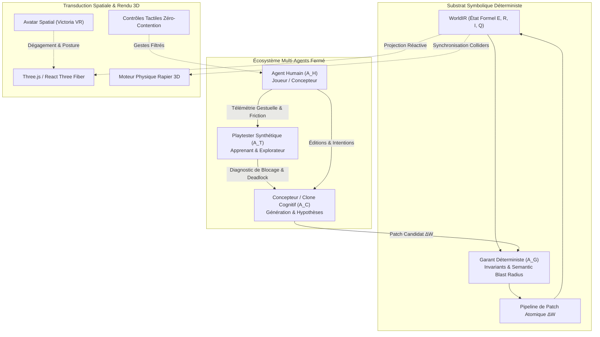

# 🏛️ Architecture de WorldPilot : Le Substrat Neuro-Symbolique Spatial (NSS)

> **Spécification d'Architecture Système & Innovation Neuro-Symbolique**  
> **Auteur** : Équipe WorldPilot / BlockOpsAI  
> **Statut** : Validé en production (57/57 suites de tests automatisées, compilation TypeScript & bundling Vite 100% stricts)  
> **Domaine d'application** : Mondes virtuels génératifs réactifs, Metaverse Victoria VR, Simulation d'IA incarnée (Embodied AI).

---

## 1. Genèse & Vision : Le "Spatial Grounding Gap"

L'avènement de l'IA générative multimodale et des modèles de fondation (LLM, World Models) a révolutionné la génération de contenu. Cependant, l'application directe de ces modèles aux environnements 3D immersifs et interactifs se heurte à un mur conceptuel : le **Spatial Grounding Gap** (le gouffre de l'ancrage spatial et causal).

### La Triple Impasse des Architectures Antérieures

1. **L'Impasse de l'ECS classique de jeu vidéo (Entity-Component-System) :**  
2. **L'Impasse des Frameworks Agentiques Textuels (ReAct, AutoGPT, Swarms) :**  
   Les architectures d'agents logiciels textuels traitent le monde comme une suite de jetons (*tokens*). Dans un univers 3D, un LLM pur souffre d'**hallucinations spatiotemporelles** : il peut déclarer qu'une pièce est posée sur un plateau alors que leurs boîtes englobantes s'interpénètrent, inventer des règles physiques contradictoires ou briser un objectif de quête en déplaçant un objet critique hors de portée.
3. **Le Problème du "Semantic Blast Radius" (Rayon d'Impact Sémantique) :**  
   Lorsqu'un créateur ou un agent modifie une scène (par exemple en ajoutant un meuble ou un accessoire), comment s'assurer que cette retouche ne bloque pas un passage d'avatar, ne désactive pas une règle de scoring préexistante et n'annule pas la complétion d'une quête ?

### L'Innovation Fondatrice de WorldPilot

WorldPilot résout cette contradiction par une architecture inédite : **le Substrat Neuro-Symbolique Spatial (Neural-Symbolic Spatial Substrate - NSS)** couplé à une **Boucle Fermée Multi-Agents à 4 Rôles ($A_H, A_T, A_G, A_C$)**.

Au lieu de confier le contrôle du monde 3D soit exclusivement à un moteur physique impératif, soit aveuglément à des réseaux de neurones, WorldPilot scinde le système en :
- Un **Noyau Symbolique Déterministe** (World Intermediate Representation - WorldIR), infalsifiable, vérifié par des invariants formels et piloté par des patches différentiels atomiques.
- Un **Moteur de Transduction Spatial 3D / Physique Rapier** découplé, dédié au rendu visuel réactif, aux forces physiques newtoniennes et à l'ergonomie haptique sans latence.
- Un **Écosystème Fermé d'Agents Hybrides** où l'humain, le testeur synthétique apprenant, le garant formel et l'avatar cognitif collaborent en boucle fermée.



---

## 2. Spécification Formelle du Modèle NSS

### 2.1 L'État Formel du Monde $W$

L'état du monde $W_t$ à l'étape $t$ est un quintuplet algébrique pur, sérialisable et déterministe :

$$W_t = \langle \mathcal{E}, \mathcal{R}, \mathcal{I}, \mathcal{Q}, \Phi \rangle$$

Où :
- $\mathcal{E} = \{e_1, e_2, \dots, e_n\}$ est l'ensemble des **Entités Spatiales**, où chaque entité $e = \langle \text{id}, \text{name}, \mathbf{p}, \mathbf{q}, \mathbf{s}, \mathcal{C}, \mathcal{V} \rangle$ possède une position $\mathbf{p} \in \mathbb{R}^3$, une orientation sous forme de quaternion $\mathbf{q} \in \mathbb{H}$, une échelle $\mathbf{s} \in \mathbb{R}^3$, un jeu d'affordances/capacités $\mathcal{C}$ (`draggable`, `receptacle`, `interactive`, `surface`, etc.) et des spécifications visuelles $\mathcal{V}$.
- $\mathcal{R} = \{r_1, r_2, \dots, r_m\}$ est l'ensemble des **Règles Causales Symboliques**, modélisées sous la forme condition-action :
  $$r: \text{trigger}(e_i, e_j) \wedge \bigwedge_k c_k(W_t) \implies \text{Actions}(\Delta W)$$
- $\mathcal{I} = \{\iota_1, \iota_2, \dots, \iota_p\}$ est l'ensemble des **Invariants du Monde** (non-chevauchement des boîtes englobantes, conservation des objets clés, bornes d'espace de travail).
- $\mathcal{Q} = \{q_1, q_2, \dots, q_k\}$ est le graphe des **Quêtes et Objectifs Pédagogiques/Gameplay** ordonnés sous forme de graphes acycliques dirigés (DAG) d'étapes.
- $\Phi$ représente l'état d'exécution du gameplay (score, vies, chronomètre, statut d'évaluation).

### 2.2 Le Patch Atomique $\Delta W$ et la Fonction de Transition Déterministe

Toute modification du monde—qu'elle émane d'une manipulation de l'utilisateur, d'un coup joué dans une partie de Go, d'une décision du Playtester ou d'une suggestion d'un LLM—est strictement exprimée sous forme d'un objet différentiel **`WorldPatch`** :

$$\Delta W = \langle \mathcal{E}^+, \mathcal{E}^-, \mathcal{E}^\Delta, \mathcal{R}^+, \mathcal{R}^-, \mathcal{I}^+, \mathcal{Q}^+, \Phi^\Delta \rangle$$

La transition d'état s'opère selon une fonction de transition pure $f_{\text{NSS}}$ :

$$W_{t+1} = f_{\text{NSS}}(W_t, \Delta W)$$

La fonction $f_{\text{NSS}}$ n'applique le patch que si et seulement si l'ensemble des invariants formels reste vérifié :

$$\forall \iota \in \mathcal{I}, \quad \iota(W_{t+1}) = \text{true}$$

Si une violation survient, le patch est soit rejeté avec un diagnostic explicite, soit réparé de manière autonome par le solveur de réparation minimale.

### 2.3 Semantic Blast Radius (SBR) & Réparation Minimale de Pareto

Le module **Semantic Blast Radius** calcule la distance structurelle induite par tout patch candidat avant de l'appliquer à la scène vivante :

$$\text{SBR}(\Delta W) = w_1 |\mathcal{E}^\Delta| + w_2 |\mathcal{E}^-| + w_3 |\mathcal{R}^\Delta| + w_4 \sum_{q \in \mathcal{Q}} \text{Breakage}(q, \Delta W)$$

Lorsque des collisions géométriques ou des ruptures de contraintes sont détectées, le moteur applique une **réparation minimale de Pareto** :

$$\Delta^* = \arg\min_{\Delta} \|\Delta\|_{\text{transform}} \quad \text{tel que} \quad \text{Violations}(W \oplus \Delta) = \emptyset$$

Ce mécanisme sépare les entités en conflit selon la normale de pénétration minimale sans jamais détruire les entités créées par l'utilisateur ni altérer l'intention de la quête active.

---

## 3. L'Écosystème Fermé Multi-Agents à 4 Pôles ($A_H, A_T, A_G, A_C$)

L'une des innovations majeures de WorldPilot réside dans sa formulation multi-agents collaborative et fermée, où l'utilisateur humain n'est pas un simple spectateur externe, mais un agent actif au sein d'une boucle d'apprentissage mutuel.

```
       ┌────────────────────────────────────────────────────────┐
       │                 Agent Humain (A_H)                     │
       │   Intention 3D, Explorations, Frictions & Hésitations   │
       └───────────────────────────┬────────────────────────────┘
                                   │
              Télémétrie Gestuelle │ Inférence d'Intention
              & Traces de Friction │ Inverse (Fitts 3D + Gaze)
                                   ▼
       ┌────────────────────────────────────────────────────────┐
       │             Playtester Synthétique (A_T)               │
       │   Apprend des échecs humains, explore l'état du monde, │
       │   identifie affordances manquantes et culs-de-sac      │
       └───────────────────────────┬────────────────────────────┘
                                   │
                  Rapport d'Audit  │ Détection de Deadlock
                  & Diagnostic     │ Spatial / Quête
                                   ▼
       ┌────────────────────────────────────────────────────────┐
       │       Concepteur & Jumeau Cognitif (A_C)               │
       │   Génère le patch minimal réparateur (WorldPatch)      │
       └───────────────────────────┬────────────────────────────┘
                                   │
                    Proposition de │ Patch Candidat
                    Modification   │ ΔW
                                   ▼
       ┌────────────────────────────────────────────────────────┐
       │              Garant Déterministe (A_G)                 │
       │   Audit SBR, Vérification des Invariants,              │
       │   Certification Formelle & Commit Atomique             │
       └───────────────────────────┬────────────────────────────┘
                                   │
               Commit dans le      │ Notification /
               WorldIR             │ Assistance Spatiale
                                   ▼
       ┌────────────────────────────────────────────────────────┐
       │              Monde 3D Réactif (WorldIR)                │
       └────────────────────────────────────────────────────────┘
```

### 3.1 $A_H$ : L'Agent Humain & Télémétrie Gestuelle Inverse
L'humain interagit dans l'espace 3D à l'aide d'interactions physiques (glisser-déposer, clics, orientation, regard). Le moteur capture :
- **L'Inférence d'Intention Inverse (IIE)** : modélisation de l'intention par la loi de Fitts 3D augmentée du temps de fixation du regard (*gaze dwell*) et de la décélération terminale du curseur :
  $$ID = \log_2\left(\frac{D}{W} + 1\right), \quad I = \left(\frac{1}{1 + 0.3 \cdot ID}\right) \cdot e^{-2 v_{\text{approach}}} \cdot \sigma(t_{\text{gaze}})$$
- **Le Détecteur de Friction Utilisateur** : analyse des actions improductives répétées (ex. tentatives répétées de déplacement sur un objet statique, hésitations prolongées $> 8\text{s}$, clics sans collision). Dès qu'un seuil critique de friction est franchi ($N_{\text{friction}} \ge 3$), une alerte est transmise au Playtester.

### 3.2 $A_T$ : Le Playtester Synthétique Apprenant
Le Playtester virtuel ne se contente pas d'exécuter des parcours scriptés ; il **apprend des comportements de l'agent humain** :
- Il consomme les traces de friction de $A_H$ pour prioriser ses simulations de tests sur les objets et zones géométriques ayant posé problème au joueur réel.
- Il simule différentes personnalités cognitives (`novice`, `systematic_explorer`, `speedrunner`, `stress_tester`).
- S'il découvre un cul-de-sac (par exemple, une quête exigeant d'insérer un objet dans un récipient alors que l'affordance `draggable` a été omise), il synthétise un diagnostic précis de blocage.

### 3.3 $A_G$ : Le Garant Déterministe (Deterministic Guarantor)
Le Garant est un automate symbolique à tolérance zéro :
- Il n'autorise aucune intervention créative d'$A_C$ ou de réparation d'$A_T$ si celle-ci engendre une régression sur les quêtes précédentes.
- Il valide le respect strict des invariants : intégrité des identifiants, unicité des références, positivité des échelles 3D, conformité des ancrages de contraintes.
- Il produit un **Certificat Formel d'Audit** accompagnant chaque version de scène.

### 3.4 $A_C$ : Le Concepteur & Jumeau Cognitif
$A_C$ incarne la dimension générative (LLM, modèles de diffusion spatiale, agent conversationnel Victoria) :
- En réponse aux diagnostics d'$A_T$, il produit une réparation minimale ciblée (par exemple, injecter l'affordance manquante sur l'objet sans toucher au reste de la scène).
- En réponse aux invites de l'humain, il compile des environnements spatiaux complets en garantissant la compatibilité ascendante.

---

## 4. Architecture des Cartouches Modulaires & Isolation Open Source

Un impératif architectural majeur d'un projet industriel open source est le respect du **principe de séparation des préoccupations** :
- Le cœur open source doit être **extrêmement léger, focalisé et sans surcharge métier**.
- La couche d'intégration Web3 (spécifique à Victoria VR, ses jetons et ses terrains virtuels décentralisés) doit être universelle et native.
- Les verticaux métiers spécialisés (gastronomie, pédagogie linguistique FLE, gouvernance d'entreprise, jeux d'arcade) ne doivent pas polluer le socle générique.

### 4.1 Registre des Cartouches de Domaine (`src/library/domainPacks.ts`)

WorldPilot introduit le concept de **Cartouches de Domaine Déclaratives** :

| Identifiant Cartouche | Nom | Rôle & Contenu | Statut de Distribution |
| :--- | :--- | :--- | :--- |
| `core-sandbox` | **WorldPilot Core Starter Pack** | Établi technique universel, cube d'apprentissage et **Terminal Web3 Victoria VR** natif. | **Par défaut dans le dépôt Open Source** |
| `escoffier-gastronomy` | **Académie Culinaire Escoffier** | Stations de découpe, cocottes en fonte, pianos de cuisson, évaluation organoleptique 3 étoiles. | Cartouche métier optionnelle |
| `paris-fle` | **Immersion Linguistique & Culturelle FLE** | Kiosque parisien, terrasse de café, menus interactifs, synthèse vocale didactique. | Cartouche métier optionnelle |
| `executive-seminar` | **Salle de Conférence & Boardroom** | Écrans partagés, pupitres de vote, tableaux d'idéation Kanban, télémétrie de prise de parole. | Cartouche métier optionnelle |
| `games-arcade` | **Arcade Rétro & Espace Tabletop** | Table de jeu de Go 9x9 traditionnelle japonaise, bols de pierres, stands de tir réactifs. | Cartouche métier optionnelle |

### 4.2 Terminal Web3 Victoria VR Natif dans le Cœur

Le support Web3 n'est pas relégué à un plugin annexe susceptible de diverger. L'entité `victoria_vr_terminal` fait partie intégrante du `core-sandbox`. Elle fournit :
- L'ancrage de propriété cryptographique des terrains virtuels (Land Presets).
- Les règles d'interaction pour le mint de scènes en NFT spatiaux et l'exportation de traces certifiées.
- La compatibilité avec les standards d'objets immersifs 3D décentralisés.

---

## 5. Formats Déclaratifs Portables : `.world.yaml` et `.world.json`

Pour s'affranchir des formats propriétaires et lourds propres aux moteurs de jeux commerciaux, WorldPilot spécifie une grammaire déclarative lisible par l'humain et directement compréhensible par les LLMs :

### 5.1 Structure d'un fichier `.world.yaml`

```yaml
# WorldPilot Declarative Spatial Substrate (.world.yaml)
# Format standardisé pour la simulation 3D réactive et l'IA incarnée

version: 1
atmosphere: "earth-atelier"
gravity: -9.81
activeQuestId: "quest_sample"

entities:
  sample_workbench:
    name: "Établi de Recherche Modulaire"
    position: [0.0, 0.0, 0.0]
    rotation: [0.0, 0.0, 0.0, 1.0]
    scale: [2.0, 0.85, 1.2]
    capabilities:
      - type: "surface"
        position: [0.0, 0.85, 0.0]
        scale: [2.0, 0.1, 1.2]

  sample_sensor:
    name: "Capteur Sensoriel 3D"
    position: [0.3, 0.9, 0.2]
    rotation: [0.0, 0.0, 0.0, 1.0]
    scale: [0.15, 0.15, 0.15]
    capabilities:
      - type: "draggable"
      - type: "interactive"

rules:
  rule_sample_sensor:
    trigger: "click"
    conditions:
      - type: "sourceIs"
        sourceId: "sample_sensor"
    actions:
      - type: "playSound"
        sound: "teleport"

invariants:
  inv_sample_safety:
    description: "Le capteur ne doit pas chuter sous le plancher de sécurité"
    targetEntityId: "sample_sensor"
    condition: "position.y >= -1.0"
```

### 5.2 Parseur Zéro-Dépendance et Zéro-CVE

Plutôt que d'introduire des dépendances NPM volumineuses (`js-yaml`, etc.) sujettes aux vulnérabilités d'injection et augmentant la taille du bundle client, WorldPilot intègre son propre parseur/sérialiseur récursif autonome dans [`src/engine/worldFormat.ts`](file:///Users/b.delb/Documents/antigravity/worldpilot/src/engine/worldFormat.ts) :
- Parsing YAML récursif à indentation stricte pour tableaux, objets imbriqués, scalaires et booléens.
- Validation structurelle de schéma avec rapport d'erreurs intelligible.
- Export et import bidirectionnels directs avec `Blob` et téléchargement navigateur en un clic.

---

## 6. Transduction Physique 3D & Ergonomie Tactile Zéro-Contention

La manipulation d'objets en 3D dans le navigateur pose des défis d'ergonomie physique souvent sous-estimés :

### 6.1 Élimination de la Contention de Pointeur (Canvas Pointer Lock)
Lorsqu'un utilisateur clique sur un objet 3D pour le faire glisser sur une table, le système de contrôle de caméra orbitaire (`OrbitControls`) cherche simultanément à faire pivoter la vue. Cette concurrence produit des saccades et des déplacements d'objets erratiques.

**Solution WorldPilot** :
1. Dès l'événement `pointerdown` capté par un maillage portant l'affordance `draggable`, un événement global de verrouillage `worldpilot_lock_camera_controls` est diffusé sur `window`.
2. Le composant `CameraRig` désactive immédiatement la rotation, le pan et le zoom d'`OrbitControls` :
   ```tsx
   <OrbitControls enabled={!isDragging3D && !isCameraLocked} ... />
   ```
3. L'événement `pointerup` (attaché globalement sur `window` pour parer aux sorties d'écran impromptues) libère le verrouillage en restituant un contrôle fluide de la caméra.

### 6.2 Élimination de l'Occlusion Raycast par le DOM HTML
Les étiquettes textuelles de survol 3D (rendues via des conteneurs HTML superposés) bloquaient les rayons de sélection Three.js (`raycaster`), empêchant la saisie des petits objets (comme les pierres de Go ou les flacons d'alchimie).
- **Correctif** : Désactivation complète des événements pointeur sur les conteneurs d'UI superposés (`pointer-events: none` sur les enveloppes, et masquage temporaire des bulles de texte lors des phases actives de glisser-déposer).

### 6.3 Posture Tactique et Dégagement de l'Avatar Victoria
Dans les scénarios de jeu de société ou de réflexion face à face (jeu de Go, taquin), l'avatar compagnon Victoria ne doit pas se tenir sur le côté comme dans un atelier, ni obstruer le champ de vision ou les pièces du plateau :
- **Posture d'Adversaire** : L'avatar adopte automatiquement une position opposée à l'utilisateur face au plateau ($x = 0.0, z = -1.15$), tournée vers le goban.
- **Évitement de Collisions Déterminé** : Lorsque des entités de jeu occupent la zone, l'avatar effectue son recul d'évitement selon l'axe orthogonal $Z$ afin de préserver l'accès latéral de manipulation pour le joueur.

---

## 7. Organisation Modulaire du Code : Zustand Slice Pattern

Le store central de WorldPilot a été refactorisé d'un fichier monolithique vers le **Zustand Slice Pattern**, garantissant la maintenabilité sans rupture de compatibilité pour le code existant :

```
src/engine/
├── slices/
│   ├── types.ts                  # Interfaces unifiées & contrats des slices
│   ├── worldSlice.ts             # WorldIR pur, patches vérifiés, quêtes, export YAML/JSON
│   ├── agentEcosystemSlice.ts    # Multi-agents (Humain, Playtester, Garant, Friction)
│   └── runtimeUISlice.ts         # Caméra, cinéma, audio, presets de domaine, modales
├── store.ts                      # Assemblage du store combiné & ré-exports ascendants
├── worldFormat.ts                # Moteur déclaratif YAML/JSON zéro-dépendance
└── autonomousSpatialEngine.ts    # Dynamique spatiale & inférence causale
```

### 7.1 Signature Typée Unifiée
Chaque slice est typé via le motif `StateCreator<StoreState, [], [], SliceInterface>`, permettant à chaque tranche d'accéder aux actions et à l'état des autres tranches via `get()` et `set()` sans couplage circulaire :
```typescript
export const createAgentEcosystemSlice: StateCreator<
  StoreState,
  [],
  [],
  AgentEcosystemSlice
> = (set, get) => ({
  // Accès direct à get().world, get().applyPatch(), get().logCognitiveAction()
  ...
});
```

---

## 8. Validation Industrielle & Zéro-Régression

L'architecture est systématiquement éprouvée par un banc de tests exhaustif exécuté en continu :

- **57 Suites de Tests Unitaires & d'Intégration** ([`src/tests/library.test.ts`](file:///Users/b.delb/Documents/antigravity/worldpilot/src/tests/library.test.ts)) :
  - **Suites 1 à 45** : Invariants physiques, affordances, évaluation culinaire Escoffier, phonétique FLE, immersion VR.
  - **Suites 46 à 52** : Repose sur mobilier, non-enfouissement, sauvetage d'objets déchus, stand de tir arcade, taquin 5x5.
  - **Suite 53** : Minimum Viable Environment (MVE) et auto-synthèse de quêtes.
  - **Suite 54** : Jeu de Go 3D, dégagement d'avatar et fluidité de pose.
  - **Suite 55** : Télémétrie gestuelle inverse, détection de friction humaine et inférence bayésienne.
  - **Suite 56** : Écosystème multi-agents fermé ($A_H, A_T, A_G, A_C$) et auto-réparation sous contrôle du Garant.
  - **Suite 57** : Sérialisation et désérialisation déclarative YAML/JSON (roundtrip) et isolation des cartouches modulaires.
- **Résultat de Build Production** :
  ```
  npm run build (tsc && vite build) -> 0 erreur TypeScript, 1240 modules compilés en 25.6s
  npm run test:library -> 57/57 suites validées avec succès
  ```

---

---

## 10. Moteur de Variabilité Procédurale, Graines Déterministes (Seeds) & Serious Gaming 3D

Pour transformer une simple maquette 3D interactive en un **véritable jeu d'apprentissage actif et rejouable**, WorldPilot intègre un **Moteur de Défis Procéduraux Déterministes** ([`src/engine/proceduralChallengeEngine.ts`](file:///Users/b.delb/Documents/antigravity/worldpilot/src/engine/proceduralChallengeEngine.ts)).

### 10.1 L'Architecture Hybride à Deux Étages (Prompt-as-Director $\rightarrow$ Procedural-as-Runtime)

Une question architecturale clé se pose : *peut-on introduire les pannes et aléas directement via le prompt LLM, ou cela nécessite-t-il un générateur procédural dédié ?*

WorldPilot tranche en faveur d'un **couplage hybride à deux étages** :

```
             NIVEAU 1 : INTENTION EN LANGAGE NATUREL (LLM / Prompt)
  « Crée un défi de dépannage électrique avec graine #402 et budget de 3 mesures »
                                    │
                                    ▼
                    COMPILATION EN CONTRAT PARAMÉTRIQUE
            { domain: 'PHYSICS_ELECTRICITY', seed: 402, difficulty: 'hard' }
                                    │
                                    ▼
             NIVEAU 2 : GÉNÉRATEUR PROCÉDURAL LOCAL (Seeded PRNG à 60 FPS)
   - Tirage de la panne masquée (ex: Court-circuit franc R = 0.02 Ω)
   - Injection de bruit de tolérance physique réelle (±5% sur R et U)
   - Perturbation spatiale de l'établi sans collision
   - Instanciation des sondes de multimètre avec compteur de budget
   - Quête d'investigation en 4 étapes & Invariant de diagnostic
```

#### Pourquoi le LLM seul échoue en jeu d'apprentissage :
1. **Latence critique :** Un appel réseau LLM prend 1 à 4 secondes. Dans un jeu interactif, l'apprenant manipule un volant ou une sonde en temps réel ; la conséquence physique doit survenir à la milliseconde près ($16.6\text{ms}$ à 60 FPS).
2. **Reproductibilité scientifique (Graines / Seeds) :** Un formateur ou une cohorte d'élèves doit pouvoir jouer exactement le même cas d'étude avec la `Graine #402` pour comparer leurs arbres de diagnostic et leurs scores d'efficience. Le LLM pur est stochastique et non rejouable.
3. **Garantie de Solvabilité (Solvability Invariant) :** Un générateur procédural garantit formellement que la panne générée possède au moins une solution mesurable et réparable avec les outils mis à disposition.

### 10.2 Le PRNG Déterministe à Graines (`SeededPRNG`)

Le sous-système utilise un générateur à congruence linéaire (LCG) déterministe avec distribution uniforme, gaussienne et choix pondéré :

$$X_{n+1} = (a X_n + c) \pmod m, \quad a = 1664525, \ c = 1013904223, \ m = 2^{32}$$

Une graine numérique ou textuelle (`seed = 402` ou `seed = "atelier-alain"`) garantit la parité d'exécution sur n'importe quel navigateur client sans nécessiter d'état côté serveur.

### 10.3 Catalogue de Pannes Multi-Domaines & Tolérances Physiques Réelles

Le moteur couvre quatre grands domaines de formation :

| Domaine | Types de Pannes Procédurales | Effet Physique Masqué | Outils & Validation |
| :--- | :--- | :--- | :--- |
| **Électronique & Électricité** (`PHYSICS_ELECTRICITY`) | Court-circuit franc, fusible fondu, dérive ohmique (+85%), cosse de masse desserrée. | $R \to \infty$, $R \to 0$, $U$ anormal, fluctuations $5-40\,\Omega$. | Multimètre numérique, boîte à décades, fusible 0.5A. |
| **Mécanique & Assemblage** (`MECHANICS_ASSEMBLY`) | Tourillon manquant, excentrique mal verrouillé à 45°, omission d'équerre anti-basculement ASTM F2057. | Absence d'appui, jeu latéral sous charge, centre de gravité instable. | Clé Allen 4mm, sachet quincaillerie, zone murale. |
| **Thermodynamique & Fluides** (`THERMODYNAMICS`) | Emballement thermique régulation, fuite adiabatique sur vase Dewar. | $T > 200^\circ\text{C}$ permanent, fuite thermique de $0.85^\circ\text{C}/\text{min}$. | Sonde thermocouple, régulateur PWM, couvercle isolant. |
| **Gastronomie & Chimie** (`CHEMISTRY_GASTRONOMY`) | Saturation en sel (+120%), oxydation précoce des sucs aromatiques. | Masse $15\text{g}$ au lieu de $6\text{g}$, dégradation enzymatique. | Réfractomètre, huile d'olive, bouquet garni. |

**Bruit de Tolérance Réelle :**  
Chaque composant se voit appliquer une micro-variation stochastique réelle de $\pm 5\%$. Une résistance de $100\,\Omega$ nominale mesure en réalité $98.4\,\Omega$ ou $103.1\,\Omega$. L'étudiant apprend à **mesurer et analyser** plutôt qu'à deviner une constante de cours.

### 10.4 Le Mode Roguelike Pédagogique & Score d'Efficience

Le mode de jeu rompt avec le tutoriel passif (« clique sur A, puis sur B ») en introduisant :
- **Un Budget de Mesures Fini :** Le joueur dispose de 3 mesures de multimètre autorisées (représentées par des cœurs dans le HUD). Chaque prise de sonde décrémente le quota.
- **Un Chronomètre d'Intervention :** Simule l'urgence d'une intervention industrielle (60s à 180s selon la difficulté).
- **Le Score d'Efficience Cognitive :** Noté sur 100 points, pénalisé par les mesures inutiles et bonifié par la rapidité de diagnostic conforme (Taxonomie de Bloom niveaux 5 et 6).
- **Relance Instantanée par Graine :** Le bouton `🎲 Nouvelle Graine` du HUD permet de générer instantanément un nouveau tirage de panne en un clic sans rechargement de page.

---

## 11. Ergonomie de Conception : La Réponse Contrarienne à l'Édition YAML

Une question fondamentale se pose lors de la création d'expériences 3D interactives : **faut-il construire un éditeur visuel de fichiers YAML (formulaires ou graphe de nœuds) ou tout confier au prompt textuel ?**

WorldPilot adopte une position **contrarienne mais pragmatique**, issue de la pratique opérationnelle des moteurs de jeu et de simulation.

### 11.1 Le Double Écueil : Node Spaghetti vs Illusion du "Tout-au-Prompt"

1. **Le piège de l'éditeur de YAML / Node Graph :**
   - Remplir à la main des dizaines de champs de coordonnées pour chaque objet et relier manuellement des boîtes d'événements prend 15 à 20 minutes, là où un prompt met 2 secondes.
   - Dès qu'une scène compte plus de 4 objets et 6 règles causales, les graphes nodales (type Unreal Blueprints ou Scratch) se transforment en un plat de « spaghettis » illisible où l'auteur passe 80 % de son temps à organiser des boîtes plutôt qu'à concevoir.
2. **La faillite du 100 % prompt sur les 20 % finaux :**
   - Tenter d'exprimer des ajustements millimétriques en langage naturel (*« décale la fiole de 3 cm vers la gauche et incline de 12 degrés »*) est une hérésie cognitive entraînant de multiples allers-retours stochastiques frustrants.
   - Corriger un petit bug de drapeau logique via un prompt global risque d'amener le LLM à réécrire la moitié de la scène et casser des règles existantes.

### 11.2 Le Modèle Asymétrique Hybride de WorldPilot

WorldPilot distribue la charge de travail selon les forces cognitives de chaque modalité :

```
┌────────────────────────────────────────────────────────┐
│  1. MACRO-INTENTION (Le Prompt règne en maître)        │
│  "Génère un atelier mécanique avec berline et batterie"│
│  → 0 à 80 % de l'expérience créée en 2 secondes        │
└──────────────────────────┬─────────────────────────────┘
                           ▼
┌────────────────────────────────────────────────────────┐
│  2. MICRO-AJUSTEMENT 3D (Manipulation spatiale directe)│
│  Gizmos de translation / rotation à la souris          │
│  → Patch le YAML automatiquement en sous-main          │
└──────────────────────────┬─────────────────────────────┘
                           ▼
┌────────────────────────────────────────────────────────┐
│  3. OBSERVABILITÉ RÉACTIVE (Inspecteur d'état vivant)  │
│  Pas pour créer des règles, mais pour les voir vivre : │
│  • Flags allumés en vert/rouge en temps réel           │
│  • Clic pour forcer un flag ou déclencher une règle    │
│  • Micro-prompts in-situ sur un objet précis           │
└────────────────────────────────────────────────────────┘
```

### 11.3 Composants Réalisés & Intégration

1. **Gizmo 3D dans le Viewport (`SelectedEntityGizmo`) :**  
   Intégré via `@react-three/drei` (`TransformControls`). Permet de basculer instantanément entre translation orthogonale (flèches X, Y, Z) et rotation angulaire. Met à jour le `WorldIR` avec coordonnées arrondies ($\pm 0.001$) et verrouille temporairement les contrôles caméra durant le glissement.
2. **Micro-Prompt In-Situ par Objet :**  
   Champ de saisie contextuel rattaché à l'entité sélectionnée. Résout les instructions ciblées (`{ selectedEntityId: entity.id }`) sans régénérer ni écraser le reste du monde.
3. **HUD d'Observabilité Réactive & Debug Causal (`CausalObservabilityHUD`) :**  
   Tiroir flottant temps réel affichant les drapeaux d'état (`world.flags`) avec inversion en 1 clic pour tester immédiatement des branches de scénarios complexes, déclencheur unitaire de règles causales, statut des invariants formels, injection de défis procéduraux roguelike et visionneuse de substrat YAML en direct.
4. **Inspecteur & Éditeur de Substrat Dual YAML / JSON (`JsonEditor`) :**  
   Intégré directement dans la barre d'outils (`WorldIR`), offrant une bascule instantanée entre la syntaxe YAML (substrat universel hautement lisible pour humains et LLMs) et JSON (WorldIR brut), avec validation syntaxique en direct, alertes d'invariants, téléchargement de fichiers `.world.yaml` et bouton de raccordement direct au HUD d'observabilité.
5. **Raccourcis Développeur & Clavier :**  
   - Touche `F2` ou `Ctrl/Cmd + D` : ouverture/fermeture instantanée du HUD d'observabilité.
   - Touche `Shift + G` : cycle rapide des modes Gizmo (Off $\to$ Translation $\to$ Rotation $\to$ Off).

---

## 12. Conclusion : De la Simulation Interactive aux Modèles de Mondes

L'architecture **NSS (Neural-Symbolic Spatial Substrate)** de WorldPilot établit un nouveau standard pour la convergence entre IA générative, spatial computing et Web3. En mariant la rigueur d'un substrat symbolique vérifiable à la flexibilité d'un écosystème d'agents apprenants et d'un moteur procédural de jeu d'apprentissage, WorldPilot démontre qu'il est possible de créer des univers virtuels à la fois **infiniment adaptatifs, scientifiquement reproductibles et strictement fiables**.

Cette fondation pave la voie vers la prochaine frontière de l'intelligence artificielle : les **modèles de mondes fondationnels (Foundation World Models)** capables de former, d'évaluer et de déployer des agents incarnés dans des environnements réels et virtuels avec des garanties formelles de sécurité et de cohérence.


